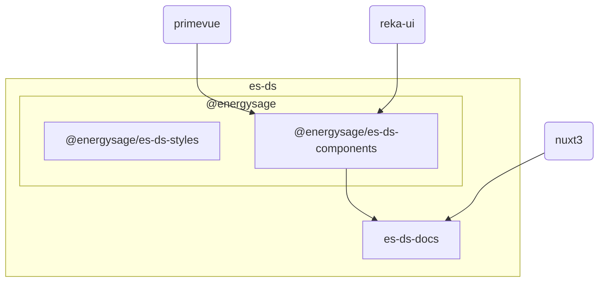

# EnergySage Design System

See the documentation and demonstrations at https://design.energysage.dev/

This is a **monorepo** containing the elements required for building experiences
following the EnergySage Design System, or _es-ds_ for short.

- [Public works](#public-works)
- [The parts](#the-parts)
- [Version compatibility](#version-compatibility)
- [Contributing](#contributing)

NOTICE: this is a vue3 based design system, if you're working with a vue2 based micro-frontend, please see [EnergySage/es-ds-legacy](https://github.com/EnergySage/es-ds-legacy) instead

## Public works

This repository `es-ds` **is public** and the contents are licensed under the
[MIT](https://tldrlegal.com/license/mit-license#summary)

For that reason discussion and documentation specific to EnergySage should probably be kept
within private org channels.

### EnergySage specific channels

For EnergySage specific resources & channels see the
[Quick Links section of the Design System confluence page](https://energysage.atlassian.net/wiki/spaces/DS/overview#%F0%9F%96%B1%EF%B8%8F-Quick-Links)

## The parts

Starting in version 3.0, the EnergySage Design System is composed of 2 core npm packages:

- [@energysage/es-ds-styles](https://www.npmjs.com/package/@energysage/es-ds-styles)
- [@energysage/es-ds-components](https://www.npmjs.com/package/@energysage/es-ds-components)



**es-ds-styles**

- [es-ds-styles](es-ds-styles/) started as a fork of **Bootstrap 4**.
- This package overrides the `_variables.scss` file in Bootstrap to the defaults required by the EnergySage design system.
- There are additional variables and colors that diverge and extend from the core
Bootstrap framework.
- The SASS has also been refactored to use
[the modular system](https://sass-lang.com/blog/the-module-system-is-launched/)
and dart-sass compiler.
- Prior to v3.0, `es-ds-styles` worked with the `es-vue-base` package, which is based on
[bootstrap-vue](https://bootstrap-vue.org/). As such, there are still some legacy
Bootstrap Vue styles present in `es-ds-styles`. Those are deprecated and will be removed
in a future version.

**es-ds-components**
- [es-ds-components](./es-ds-components/) contains Vue 3 components for use in Nuxt 4 projects.
It is primarily based on [Reka UI](https://reka-ui.com/) and [PrimeVue v3](https://v3.primevue.org/), with some customizations specific to EnergySage.

**es-ds-docs**
- This is the design system documentation site powered by Nuxt 4.
- It also serves a reference for
how to integrate `es-ds` packages into a Nuxt 4 project.

## Version compatibility

Each `es-ds-components` release is built and tested against one specific `es-ds-styles` release, and npm
does not enforce that pairing: `es-ds-components` lists `es-ds-styles` only as a dev dependency (or, before 5.4.3,
as a `^` dependency that accepts any newer 3.x release). **When upgrading, always move both packages to a pairing
listed below.** Installing the newest version of each within a major is not safe. For example, `es-ds-styles` 3.5.9
pairs with `es-ds-components` 5.7.2 or 5.7.3, not with 3.7.7.

### Versioning history

| Releases | How the versions relate |
| --- | --- |
| 3.0.0 – 3.2.3 | **Shared version numbers.** `es-ds-styles` was only published when it changed, so some numbers (e.g. 3.0.1) exist only for `es-ds-components`. |
| `es-ds-styles` 3.3.0 – 4.1.0<br>`es-ds-components` 3.3.1 – 6.3.3 | **Diverged.** Starting with the adoption of release-please on 2025-07-23, each package was versioned independently and the numbers stopped lining up. Use the table below. |
| 6.4.0 and later | **Lockstep.** Every release publishes both packages with the same version, whether or not both changed. Install matching versions. |

### Compatible pairings

Any `es-ds-components` version in a row works with that row's `es-ds-styles` version.

| es-ds-styles | es-ds-components |
| --- | --- |
| 6.4.0 and later | Same version as `es-ds-styles` |
| 4.1.0 | 6.2.0, 6.3.0, 6.3.1, 6.3.2, 6.3.3 |
| 4.0.0 | 6.0.0, 6.1.0, 6.1.1 |
| 3.5.9 | 5.7.2, 5.7.3 |
| 3.5.8 | 5.6.1, 5.6.2, 5.7.0, 5.7.1 |
| 3.5.7 | 5.5.3, 5.5.4, 5.5.5, 5.5.6, 5.6.0 |
| 3.5.6 | 5.5.2 |
| 3.5.5 | _None published; skip this version_ |
| 3.5.4 | 5.4.4, 5.5.0 |
| 3.5.3 | 5.4.3 |
| 3.5.1 | _None published; skip this version_ |
| 3.5.0 | 5.4.0 |
| 3.4.1 | 5.3.1 |
| 3.4.0 | 5.3.0 |
| 3.3.4 | 5.0.2, 5.1.0, 5.2.0 |
| 3.3.3 | 5.0.1 |
| 3.3.2 | 4.1.1, 4.1.2, 4.2.0, 5.0.0 |
| 3.3.1 | 3.3.2, 3.4.0, 3.5.0, 3.6.0, 3.6.1, 3.6.2, 3.7.0, 3.7.1, 3.7.2, 3.7.3, 3.7.4, 3.7.5, 3.7.6, 3.7.7, 4.0.0, 4.0.1, 4.0.2, 4.0.3, 4.1.0 |
| 3.3.0 | 3.3.1 |
| 3.2.1 | 3.2.1, 3.2.2, 3.2.3 |
| 3.2.0 | 3.2.0 |
| 3.1.6 | 3.1.6, 3.1.7 |
| 3.1.3 | 3.1.4, 3.1.5 |
| 3.1.0 | 3.1.0, 3.1.1, 3.1.2, 3.1.3 |
| 3.0.3 | 3.0.3, 3.0.4, 3.0.5, 3.0.6, 3.0.7, 3.0.8, 3.0.9, 3.0.10, 3.0.11 |
| 3.0.0 | 3.0.0, 3.0.1, 3.0.2 |

Each pairing is the `es-ds-styles` version that `es-ds-components` declared in its published `package.json`, which
is always the latest `es-ds-styles` release at the time. Versions that were tagged but never published to npm
(`es-ds-styles` 3.5.2; `es-ds-components` 3.3.0, 5.4.1, 5.4.2 and 5.5.1) are left out.

## Contributing

### Setting up the repo

clone `git@github.com:EnergySage/es-ds.git`

When publishing changes you will commit to the _origin_ branch of the _es-ds_
repo. So your git set-up should look like this:

```bash
$ git remote -v
origin  git@github.com:EnergySage/es-ds.git (fetch)
origin  git@github.com:EnergySage/es-ds.git (push)
```

### Installing Dependencies and Linking packages

1. `make install && make symlink` - installs all packages from npm

### Development workflow

```
make dev
```

This command will:

- Locally link your `es-ds-styles` and `es-ds-components` folders to the `es-ds-docs` Nuxt app
- Start the `es-ds-docs` local dev server

You can then make changes as desired in either upstream package folder and the local dev server should immediately reflect those changes.

```
make unlink
```

This command will:

- Undo the local linking set up by the above command
- Reinstall the public NPM versions of the `es-ds-styles` and `es-ds-components` packages

This enables you to run the `es-ds-docs` server with the state of code that is publicly available on NPM.

```
cd es-ds-docs
npm run dev
```

These commands will:
- Run the `es-ds-docs` local dev server without locally linking to the `es-ds-styles` and `es-ds-components` packages folders
- Whichever versions of the two upstream packages are installed (or already locally linked) will be used

### Updating the changelog

Changelogs are managed automatically by release-please, based on the pull request titles. See the individual changelogs:
- [es-ds-styles](./es-ds-styles/CHANGELOG.md)
- [es-ds-components](./es-ds-components/CHANGELOG.md)

`es-ds-docs` has no changelog of its own; see the
[commit history of its folder](https://github.com/EnergySage/es-ds/commits/main/es-ds-docs) instead.

### Publishing and Versioning

Publishing and versioning is automated through release-please.
Upon merging to `main`, a release-please PR titled
`chore: release es-ds-styles and es-ds-components <version>` will be created or updated
with your changes in the description. Merging this release-please PR will create a
release automatically, and also deploy to the documentation site.

`es-ds-styles`, `es-ds-components` and `es-ds-docs` are always released together with the same
version, even when only one of them changed. This is handled by release-please's `linked-versions`
plugin in [release-please-config.json](./release-please-config.json); see
[Version compatibility](#version-compatibility) for why it matters.

Changes that only touch `es-ds-docs` never trigger a release, since there is nothing to publish to npm.
Instead, they deploy to the documentation site as soon as they are merged to `main`.
